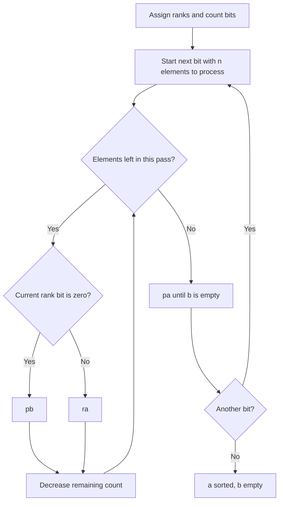

*This project has been created as part of the 42 curriculum by mibaboul, jecourto.*

# Push_swap

## Description

Push_swap is a C project that sorts distinct integers using two stacks and a
restricted set of operations. The program receives the initial contents of stack
`a` and prints the instructions needed to sort it in ascending order. Stack `b`
starts empty and provides temporary storage. At the end, the smallest value must
be at the top of `a`, and `b` must be empty.

The challenge is to reduce the number of generated instructions. This README
details two implementations: minimum extraction (`--simple`) and binary radix
sorting (`--complex`). Their complexity is measured in **Push_swap operations**,
as required by [the subject](subject.pdf).

## Instructions

### Compilation

Build from the repository root with a C compiler (`cc`) and `make`:

```sh
make
```

The Makefile builds the included Libft and links the `push_swap` executable with
`-Wall -Wextra -Werror`. No separate installation is needed.

| Command | Effect |
| --- | --- |
| `make` or `make all` | Build the executable. |
| `make bonus` | Build the bonus `checker` executable. |
| `make clean` | Remove project and Libft object files. |
| `make fclean` | Also remove the executable and Libft archive. |
| `make re` | Clean everything and rebuild. |

### Running the program

The first integer is the top of stack `a`. Integers can be separate arguments,
grouped inside a quoted argument, or a mixture of both:

```sh
./push_swap --simple 3 1 2
./push_swap --complex "4 1 3 2"
./push_swap --complex "4 1" 3 2
./push_swap --simple -3 +2 0 -1
```

| Option documented here | Effect |
| --- | --- |
| `--simple` | Force minimum extraction, with an O(n²) operation bound. |
| `--complex` | Force binary radix sorting, with an O(n log n) operation bound. |
| `--bench` | Add statistics on standard error after sorting. |

Use one strategy selector per invocation. Options are separate arguments and may
appear before or after the integers. `--bench` can accompany either selector.

Instructions go to **standard output**, one per line. For example:

```sh
./push_swap --simple 3 1 2
```

```text
ra
pb
pb
pb
pa
pa
pa
```

To count instructions or save them:

```sh
./push_swap --complex "4 1 3 2" | wc -l
./push_swap --complex "4 1 3 2" > operations.txt
```

The first command reports `12`.

### Input validation

Each value must be a signed decimal integer in the range
`-2147483648` to `2147483647`. Optional `+` or `-` signs and leading zeros are
accepted. Duplicate detection compares numeric values, so `1` and `+01` are
duplicates. Whitespace can separate numbers inside an argument.

Invalid input prints exactly `Error` followed by a newline to standard error and
exits with a failure status. Examples include:

```sh
./push_swap --simple 3 2 3          # Duplicate value
./push_swap --complex 2147483648   # Outside the int range
./push_swap --simple 0 one 2       # Invalid integer
./push_swap --simple ""           # Empty argument
./push_swap --unknown 1 2          # Unknown option
./push_swap --simple --complex 2 1 # Multiple strategy selectors
```

Calling `./push_swap` without arguments produces no output. With either documented
strategy, an already sorted input or a single integer needs no operations.
Options alone, without integers, are rejected.

### Benchmark and checker

`--bench` reports the initial disorder as a percentage with two decimal places,
the selected strategy and its operation complexity, the total instruction count,
and the count of each of the eleven operation types. The instruction stream stays
on standard output; statistics go to standard error.

```sh
./push_swap --complex --bench "4 1 3 2" > /dev/null
```

```text
[bench] disorder :66.67%
[bench] strategy :Complex | O(n*log(n))
[bench] total operations : 12
[bench] sa : 0 sb : 0 ss : 0 pa : 4 pb : 4
[bench] ra : 4 rb : 0 rr : 0 rra : 0 rrb : 0 rrr : 0
```

To keep both streams separately:

```sh
./push_swap --complex --bench "4 1 3 2" > operations.txt 2> bench.txt
```

Build the bonus checker and give it the same initial integers as `push_swap`:

```sh
make bonus
./push_swap --complex --bench "4 1 3 2" 2> bench.txt | ./checker "4 1 3 2"
```

The result is `OK` when `a` is sorted and `b` is empty, or `KO` otherwise.
The checker reads the eleven supported instructions from standard input until
EOF, with a newline after each instruction. Invalid integers or instructions
print `Error` to standard error. It accepts integers only, without strategy or
benchmark options. With no arguments it exits silently. Its dedicated sources
are `checker_bonus.c`, `checker_ops_bonus.c`, and `checker_bonus.h`.

## Stack model and operations

Throughout the examples, stacks are written **from top to bottom, left to right**:
`[3, 1, 2]` means that `3` is the top element. `[]` means an empty stack.

### Circular doubly linked lists

Each stack stores its top pointer and size. Each node contains an integer value,
a rank used by radix sorting, and `next` and `prev` pointers.

```text
                   top
                    |
                    v
              [3] <--> [1] <--> [2]
               ^                 |
               +------ next -----+

    next: 3 -> 1 -> 2 -> 3
    prev: 3 -> 2 -> 1 -> 3
```

The tail is `top->prev`, and the head after a forward rotation is `top->next`.
For one node, both links point to that node; an empty stack has a null top.
Rotations move the top pointer, and pushes detach and relink an existing node.
These operations take O(1) CPU time each and require no new node allocation.

### Available instructions

| Instruction | Effect |
| --- | --- |
| `sa` | Swap the first two values in `a`. |
| `sb` | Swap the first two values in `b`. |
| `ss` | Perform `sa` and `sb` together. |
| `pa` | Move the top of `b` to the top of `a`. |
| `pb` | Move the top of `a` to the top of `b`. |
| `ra` | Move the top of `a` to its bottom. |
| `rb` | Move the top of `b` to its bottom. |
| `rr` | Perform `ra` and `rb` together. |
| `rra` | Move the bottom of `a` to its top. |
| `rrb` | Move the bottom of `b` to its top. |
| `rrr` | Perform `rra` and `rrb` together. |

A swap or rotation leaves a stack with fewer than two elements unchanged. A push
from an empty source leaves both stacks unchanged. A combined instruction counts
as **one emitted operation**, even though it affects both stacks.

## Algorithms

### Simple sort: minimum extraction

Implementation: [simple_sort.c](simple_sort.c).

This adaptation of selection sort repeatedly removes the smallest remaining
value from `a`. It provides a straightforward baseline whose steps are easy to
trace and whose operation count has a quadratic upper bound.

1. Return immediately if `a` is already sorted and `b` is empty.
2. Scan `a` to find the minimum and its zero-based position `p`.
3. Bring it to the top using the shorter rotation direction. For a stack of size
   `k`, use `p` rotations with `ra` when `p <= k / 2`; otherwise use `k - p`
   reverse rotations with `rra`. Ties use `ra`.
4. Execute `pb`, then repeat until `a` is empty.
5. Execute `pa` until `b` is empty.

```text
Find minimum in a
        |
        v
Choose shorter path: ra or rra
        |
        v
pb: place minimum on b ----> repeat while a is not empty
        |
        v
pa: return every element to a
```

For example, in `[4, 3, 2, 1, 5]`, the minimum has position `3`. Two `rra`
operations bring it to the top, instead of three `ra` operations.

#### Complete example: `3 1 2`

| Step | Instruction | Stack `a` | Stack `b` |
| --- | --- | --- | --- |
| Initial | — | `[3, 1, 2]` | `[]` |
| 1 | `ra` | `[1, 2, 3]` | `[]` |
| 2 | `pb` | `[2, 3]` | `[1]` |
| 3 | `pb` | `[3]` | `[2, 1]` |
| 4 | `pb` | `[]` | `[3, 2, 1]` |
| 5 | `pa` | `[3]` | `[2, 1]` |
| 6 | `pa` | `[2, 3]` | `[1]` |
| 7 | `pa` | `[1, 2, 3]` | `[]` |

Each extracted minimum is larger than the previous one. Since `pb` puts the new
minimum on top of `b`, that stack becomes descending from top to bottom. Returning
its elements with `pa` reverses their order, leaving `a` ascending and `b` empty.

#### Complexity

At size `k`, bringing the minimum to the top requires at most `floor(k / 2)`
rotations. There are exactly `n` pushes to `b` and `n` pushes back to `a` for an
input that enters the extraction loop:

```text
operations <= sum(k = 1..n, floor(k / 2)) + 2n
           = floor(n² / 4) + 2n
           = O(n²)
```

Finding each minimum also scans the remaining nodes, giving O(n²) CPU work for
the sorting routine. It uses O(1) auxiliary memory beyond the O(n) nodes shared
between the two stacks. Already sorted input produces zero operations.

### Complex sort: binary LSD radix

Implementation: [complex_sort.c](complex_sort.c).

Radix sorting groups values by successive bits, starting with the least
significant bit (LSD). Normalizing the input to ranks makes the number of passes
depend on the number of elements, while supporting negative and positive input
values uniformly.

#### 1. Convert values to ranks

The rank of a value is the number of input values smaller than it. Because values
are distinct, ranks range from `0` to `n - 1` and preserve the original ordering.
The integer values stay in the nodes; the algorithm stores ranks separately.

For input `4 1 3 2`:

| Original value | Rank | Binary rank (`bit 1`, `bit 0`) |
| --- | --- | --- |
| `4` | `3` | `11` |
| `1` | `0` | `00` |
| `3` | `2` | `10` |
| `2` | `1` | `01` |

The same rule maps `[-10, 42, 0]` to ranks `[0, 2, 1]`. Sorting those ranks also
sorts the original signed values.

The current `set_rank` implementation compares every value with every node. This
preparation takes O(n²) CPU time and generates no Push_swap instructions.

#### 2. Distribute one bit, then restore

For each bit, starting at bit `0`, remember the initial size of `a` and process
exactly that many elements:

- If the current top rank has a `0` at that bit, execute `pb`.
- If it has a `1`, execute `ra`.
- Once all initial elements have been processed, execute `pa` until `b` is empty.

Using the initial size as the loop bound ensures that rotated elements are not
processed twice during the same pass. Repeat for every bit needed to represent
the largest rank, `n - 1`.



#### Complete example: `4 1 3 2`

The table shows the **original values**; decisions use their ranks from the table
above. Two bits are enough for ranks `0` through `3`.

| Phase | Instruction | Stack `a` | Stack `b` |
| --- | --- | --- | --- |
| Initial | — | `[4, 1, 3, 2]` | `[]` |
| Bit 0 | `ra` | `[1, 3, 2, 4]` | `[]` |
| Bit 0 | `pb` | `[3, 2, 4]` | `[1]` |
| Bit 0 | `pb` | `[2, 4]` | `[3, 1]` |
| Bit 0 | `ra` | `[4, 2]` | `[3, 1]` |
| Restore | `pa` | `[3, 4, 2]` | `[1]` |
| Restore | `pa` | `[1, 3, 4, 2]` | `[]` |
| Bit 1 | `pb` | `[3, 4, 2]` | `[1]` |
| Bit 1 | `ra` | `[4, 2, 3]` | `[1]` |
| Bit 1 | `ra` | `[2, 3, 4]` | `[1]` |
| Bit 1 | `pb` | `[3, 4]` | `[2, 1]` |
| Restore | `pa` | `[2, 3, 4]` | `[1]` |
| Restore | `pa` | `[1, 2, 3, 4]` | `[]` |

This produces twelve operations: four `ra`, four `pb`, and four `pa`.

#### Why successive passes sort the stack

Each pass places the zero-bit group before the one-bit group and preserves the
previous order within each group. The ones remain in order through rotations.
The zeros are reversed by `pb` and reversed again by `pa`, restoring their order.

After bit `0`, ranks are sorted by their lowest bit. After bit `1`, they are sorted
by their lowest two bits, because the second pass preserves the order established
inside each group. Repeating this argument through the highest bit sorts all
ranks, and therefore all original values. Every pass finishes with `b` empty.

#### Complexity

For `n >= 2`, the number of passes is `ceil(log2(n))`. A pass emits exactly `n`
distribution operations (`pb` or `ra`) and at most `n` restoration operations
(`pa`):

```text
operations <= 2n * ceil(log2(n)) = O(n log n)
```

This bound concerns **emitted operations**. The current rank calculation takes
O(n²) CPU time, so the complete sorting routine has O(n²) CPU time despite its
O(n log n) instruction bound. It uses O(1) auxiliary memory beyond the O(n) stack
nodes, including their rank fields. Sorted input and inputs smaller than two
elements return before rank calculation and emit no operations.

### Initial disorder

Before any stack operation, `calculate_disorder` counts inversions: pairs of
positions `i < j` for which `a[i] > a[j]`.

```text
total_pairs = n * (n - 1) / 2
disorder    = inversions / total_pairs
```

For fewer than two elements, the result is defined as `0`. An ascending stack has
disorder `0`; a descending stack has disorder `1`.

For `[4, 1, 3, 2]`, the inversions are `(4, 1)`, `(4, 3)`, `(4, 2)`, and `(3, 2)`.
There are six possible pairs, so the initial disorder is `4 / 6`, displayed as
`66.67%` in benchmark mode. This is a measure of pairwise order, not the percentage
of elements outside their final positions.

The current implementation examines every pair in O(n²) CPU time with O(1)
auxiliary memory. These comparisons emit no instructions. Input parsing also
performs duplicate checks against previously stored values, which can require
O(n²) comparisons overall.

### Complexity comparison

| Documented strategy | Generated operations, upper bound | CPU time including rank preparation | Auxiliary memory beyond stack nodes |
| --- | --- | --- | --- |
| Simple: minimum extraction | O(n²) | O(n²) | O(1) |
| Complex: binary radix | O(n log n) | O(n²) | O(1) |

Both methods share O(n) total storage for the integer nodes. Parsing and initial
disorder computation are additional preparation steps. The instruction bounds
describe these implementations; they do not guarantee the shortest possible
sequence for every input.

## Contributors

| Learner | Contributions covered by this README |
| --- | --- |
| `mibaboul` | Simple minimum-extraction sort and complex binary radix sort; shared work on parsing and common project components. |
| `jecourto` | Shared work on parsing and common project components. |

## Resources

- [Project subject](subject.pdf): stack rules, operation complexity model,
  benchmark format, and evaluation requirements.
- [NIST — Selection sort](https://xlinux.nist.gov/dads/HTML/selectionSort.html):
  background on repeatedly selecting the smallest remaining element. The stack
  adaptation and its instruction bound are explained above.
- [NIST — Radix sort](https://xlinux.nist.gov/dads/HTML/radixsort.html):
  background on successive digit passes and preservation of group order.

### Use of AI

AI assisted with research into algorithmic concepts, test preparation and
verification, and the preparation of this README, including explanations,
diagrams, and command examples. For this documentation, the existing C code was
examined and the illustrated command outputs were checked against the executable.
